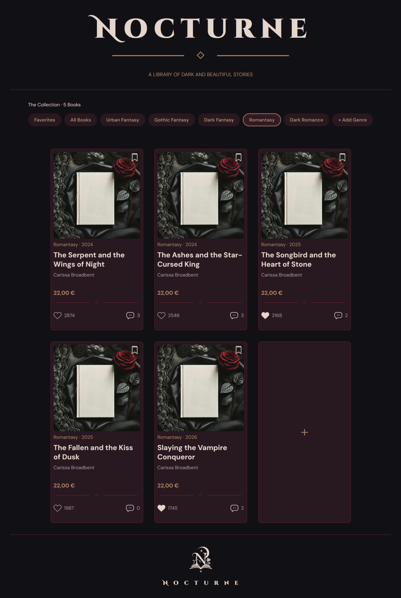
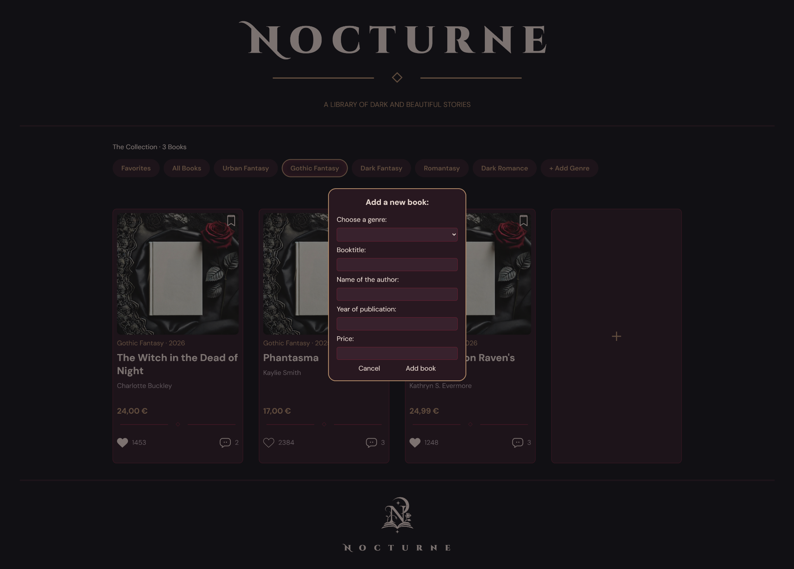
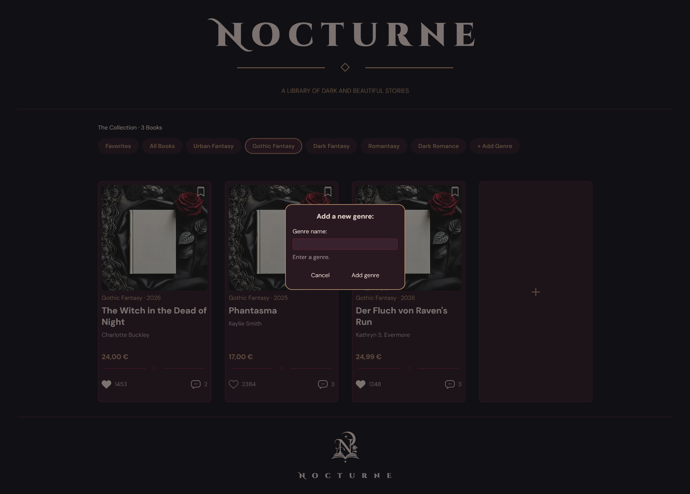

A curated digital library where you can browse dark fiction, save favorites, and add books and genres of your own.

## Table of Contents

- [About](#about)
- [Screenshots](#screenshots)
- [Features](#features)
- [Tech Stack](#tech-stack)
- [Installation](#installation)
- [Usage](#usage)
- [Project Structure](#project-structure)
- [License](#license)

## About

Nocturne is a browser-based book collection with a dark visual style. Browse books by genre, keep a favorites shelf, and add your own books and genres. I built it as a practice project during my vocational retraining in application development.

## Screenshots

The collection and its genre filters:



Add a book or create a new genre:

 

## Features

- **Book Catalog:** Browse books with their titles, authors, genres, publication years, and prices.
- **Genre Filtering:** View all books or filter the collection by genre.
- **Favorites:** Mark books with the bookmark icon and find them in the Favorites category.
- **Likes:** Like or unlike a book with the heart icon. The number of likes is displayed on each card.
- **Comments:** Read existing comments and add your own to a book.
- **Add New Books:** Add books to the collection through a form with fields for genre, title, author, year, and price.
- **Add New Genres:** Create additional genres to use as filters and when adding books.
- **Local Storage:** Keep your books, genres, likes, favorites, and comments in the same browser between visits.
- **Responsive Design:** Browse the collection on desktop and smaller screens.

## Tech Stack

- **Languages:** HTML, CSS, and vanilla JavaScript
- **Styling:** Custom CSS with locally stored fonts
- **Storage:** Browser `localStorage`

No framework, backend, or build tools are required.

## Installation

Clone the repository:

```bash
git clone https://github.com/SophiaWinterDev/Nocturne.git
cd Nocturne
```

Open `index.html` in your browser. No installation or server is needed.

## Usage

1. **Browse Books:** Choose **All Books** to see the entire collection, select a genre to filter it, or choose **Favorites** to see the books you have bookmarked.

2. **Add a Book:** Select the book card with the plus sign. Choose a genre, enter the book's title, author, publication year, and price, then select **Add book**.

3. **Add a Genre:** Select **+ Add Genre**, enter a genre name, and select **Add genre**. Your new genre will appear among the filters and in the book form.

4. **Interact with Books:** Select the **bookmark icon** at the top of a card to add or remove a book from Favorites. Select the **heart icon** at the bottom to like or unlike it. Select the **comment icon** to open the comments; enter a comment and use the send button to add it.

5. **Keep Your Changes:** Books, genres, likes, favorites, and comments are saved in your browser with `localStorage`. The initial books and their displayed likes and comments are sample data. Your changes are local to your browser.

## Project Structure

```text
Nocturne/
├── assets/
│   ├── fonts/          # Local font files
│   ├── icon/           # Logo and interface icons
│   └── img/            # Book cover image
├── CSS/                # Fonts, colors, and layout styles
├── JS/                 # Sample book data and HTML templates
├── docs/               # README banner and screenshots
├── index.html          # Page structure
├── script.js           # App behavior and local storage
├── style.css           # Base styles
└── README.md
```

## License

This project began as a bookstore assignment during my vocational retraining at Developer Akademie. I later expanded it with features of my own.
